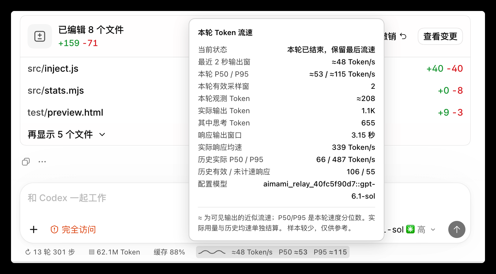
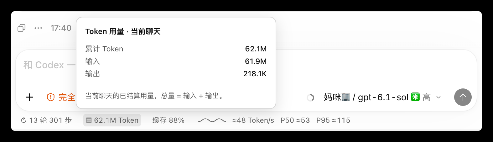
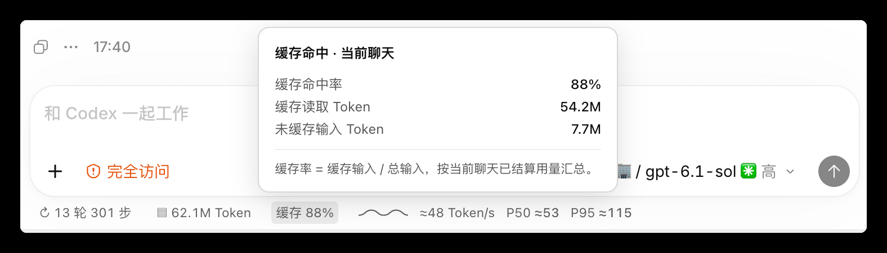
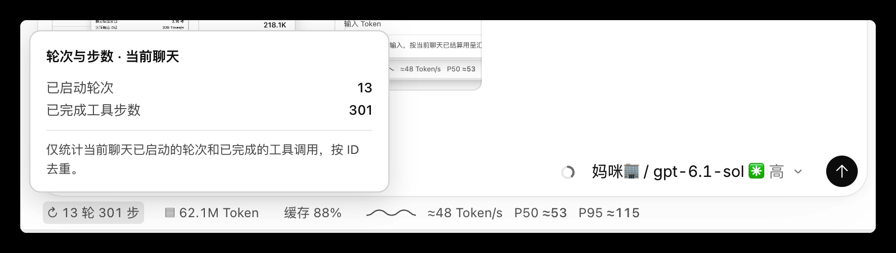

<div align="center">

# Codex Runstrip

**Codex 桌面端的轻量会话状态栏**

在输入框下方查看当前聊天的轮次、工具步数、Token 用量、缓存命中和输出速度。

[下载最新版](https://github.com/JaffryGao/codex-runstrip/releases/latest) · [更新日志](CHANGELOG.md) · [English](README.en.md)

</div>

## 界面预览



> Codex 客户端实机截图。Runstrip 是非官方运行时浮层，不是 Codex 内置功能。

<details>
<summary>查看 Token 用量、缓存与轮次卡片</summary>

**Token 用量**



**缓存命中**



**轮次与步数**



</details>

## 下载与安装

项目只提供一个轻量版，不再区分 Full/Lite，也不在应用名称中添加 Lite 后缀。下载与你的 Mac 芯片匹配的 ZIP：

| 芯片 | 下载包 | 运行要求 |
| --- | --- | --- |
| Apple Silicon（M 系列） | [`Codex-Runstrip-macos-arm64.zip`](https://github.com/JaffryGao/codex-runstrip/releases/latest) | macOS、ChatGPT 桌面端（含 Codex）、Node.js 22 或更新版本 |

目前只发布 Apple Silicon（arm64）安装包；Intel 版本暂不提供。

1. 安装 Node.js 22+（支持官方 macOS 安装包、Homebrew，或默认 `~/.nvm` 下的 nvm）。
2. 下载 ZIP、解压，将 `Codex Runstrip.app` 移入“应用程序”。
3. 保存工作并完全退出 ChatGPT/Codex，再打开 Codex Runstrip。启动器会启动带本机回环调试端口的 Codex；不会强制退出已运行的 Codex。
4. 若 macOS 阻止首次打开，按住 Control 点击应用并选“打开”，或按“系统设置 → 隐私与安全性”提示操作。

应用为本地临时签名，未经 Apple 公证。首次启动时 macOS 可能要求手动确认。请勿同时运行多个 Runstrip 副本。日志位于 `~/Library/Logs/Codex fork/launcher.log`。

## 状态栏内容

- **轮次与步数**：当前聊天已启动的任务轮次、已完成的工具调用步数。
- **Token 用量**：当前聊天日志累计输入与输出 Token。
- **缓存**：单独展示缓存命中率、缓存读取 Token、未缓存输入 Token。
- **流速**：单色动态波形与可观测输出的近似 Token/s；本轮结束后显示流式采样的 P50/P95。点击各板块查看详情。

## 数据口径与隐私

- 仅读取本机 `~/.codex/sessions` 中与当前聊天绑定的会话日志，不上传聊天内容，也不修改 Codex 安装包。
- 优先使用活动输入框的正式会话 ID 与 host；无法唯一确认时保持待统计，不猜测。切换聊天后丢弃旧请求的迟到数据。
- 轮次按 `task_started.turn_id` 去重；工具步数按已完成工具 item ID 去重。上下文用量由 Codex 自带指示器展示，Runstrip 不重复提供。
- Token 总量和缓存率按当前聊天日志汇总；首次用量记录到达前显示“待统计”，不把未知当作 0。
- 实时速度对可观测的正文与思考增量使用本机 `tiktoken 1.0.22 / o200k_base` BPE 计数。它是近似吞吐率，不是服务端精确解码速度：看不到隐藏思考和工具返回文本，客户端到达时间也不等于模型纯生成时间。没有可观测 Token 输出时不编造速度；思考、工具执行期间可能只有阶段提示。
- P50/P95 是当前轮最近最多 500 个约 1 秒有效输出窗的吞吐率分位数，不是逐 Token 延迟。只有整轮完成/中断后才显示；不足 1 秒的尾窗不参与。
- 服务端结算的实际输出 Token（含思考）、响应均速和历史分位数在流速详情中单独展示，不替代实时流速。重载页面后不能恢复此前的实时采样。
- 注入器仅连接本机回环调试端点。Codex 关闭后会自动退出；新版启动会接管已确认属于 Runstrip 的旧注入器。
- 暂不支持远端 host 的历史日志和分离聊天窗口。Codex 更新可能改变界面锚点，需随版本调整。

## 自动检查更新

启动后会在后台检查 GitHub 最新正式 Release。仅当版本更高且存在当前芯片对应的安装包时提示；点击后打开 Release 页面，不会自动下载或覆盖。网络异常、无更新或用户取消时保持静默。

## 从源码构建与验证

在安装 ChatGPT 桌面端的 macOS 上，准备 Node.js 22+、tiktoken 1.0.22 源码包及其许可证，再运行：

```bash
RUNSTRIP_TOKENIZER_SOURCE="$PWD/dependencies/tiktoken-1.0.22" \
RUNSTRIP_TOKENIZER_LICENSE="$PWD/dependencies/tiktoken-LICENSE" \
./package-release.sh
```

默认只构建一个无 Lite 后缀的轻量包。可用 `RUNSTRIP_RELEASE_ROOT` 指定新的输出目录，已有构建不会被覆盖。独立验证构建说明见 [STANDALONE.md](STANDALONE.md)（非公开发行版本）。

运行测试：

```bash
RUNSTRIP_TOKENIZER_PATH="$PWD/dependencies/tiktoken-1.0.22" \
node --test test/*.test.mjs
```

公开发行包验证可设置 `RUNSTRIP_PUBLIC_TEST_APP` 指向已构建的 `.app`；内部独立验证包使用 `RUNSTRIP_TEST_APP`，见 [STANDALONE.md](STANDALONE.md)。`test/preview.html` 使用合成数据进行 UI 回归。

## 项目说明

Codex Runstrip 是基于运行时 UI 注入的非官方实验项目，与 OpenAI 无隶属关系，也未获其背书。项目尚未选择软件许可证；第三方组件保留各自许可证。

感谢 [@LospAgile](https://github.com/LospAgile) 在 [PR #2](https://github.com/JaffryGao/codex-runstrip/pull/2) 中提供的会话绑定、BPE 流式统计与回归测试。

---

## English

The complete English documentation is available in [README.en.md](README.en.md).
