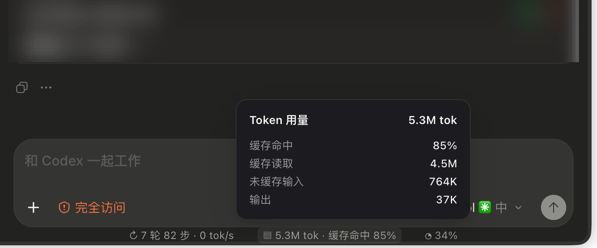
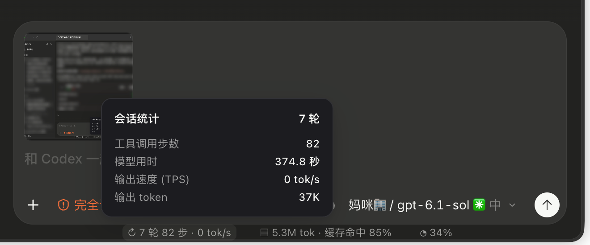
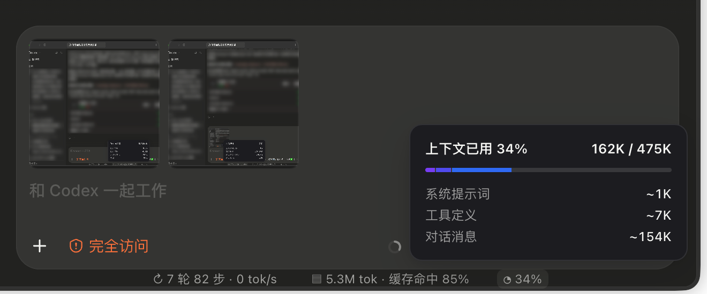

<div align="center">

# Codex Runstrip

### A glanceable session strip for Codex Desktop.

Local session signals, right below the composer.

[English](#english) · [简体中文](#简体中文) · [Download](https://github.com/JaffryGao/codex-runstrip/releases/latest)

</div>

<p align="center">
  
</p>
<p align="center">
  
</p>
<p align="center">
  
</p>

<p align="center"><sub>Actual Codex Desktop screenshots · Runtime overlay, not an official built-in feature<br>Codex 客户端实机截图 · 运行时注入浮层，非官方内置功能</sub></p>

---

## English

Codex Runstrip adds a compact, clickable status strip below the Codex Desktop composer. It surfaces session activity, token totals, cache usage, and context-window occupancy without changing Codex's installed application bundle.

### What it shows

- **Output speed:** an output-driven rectangle, recent BPE Token/s, and current-turn P50/P95 after completion.
- **Session activity:** deduplicated task turns and completed tool steps for the currently selected chat.
- **Token usage:** cumulative input and output tokens, plus the aggregate cache-hit ratio for the selected session log.
- **Context window:** the latest recorded input size against the reported context window.
- **Details on demand:** click a segment to open its breakdown.

### Install

Choose one edition from [Releases](https://github.com/JaffryGao/codex-runstrip/releases/latest):

| Edition | ZIP filename | Unpacked app | Node.js requirement |
| --- | --- | --- | --- |
| Full — recommended if unsure | `Codex-Runstrip-macos-arm64.zip` | About 121 MB | Included; no separate installation |
| Lite — for users who already have Node.js | `Codex-Runstrip-Lite-macos-arm64.zip` | About 1 MB | Install Node.js 22+ separately |

Sizes describe the existing release packages; ZIP downloads are smaller. The full edition's size comes almost entirely from its bundled Node.js runtime. The enhancements described here are source changes, not a new published release.

For a self-contained build with Node.js and the BPE tokenizer included, see [Standalone](STANDALONE.md). Full/Lite source builds can also bundle the tokenizer; without it, speed stays unavailable rather than falling back to character counts. Usage, context and turn/step counts remain available.

1. Download one of the ZIP files above.
2. Unzip it and move `Codex Runstrip.app` (Full) or `Codex Runstrip Lite.app` (Lite) to Applications.
3. Quit ChatGPT/Codex completely, then open Codex Runstrip.
4. If macOS blocks the first launch, Control-click the app and choose **Open**.

When upgrading from `Codex Status Bar.app` or `Runstrip.app`, use the newly named app from this package; existing installed copies are not renamed automatically.

Both packages target Apple Silicon Macs. They are alternatives: launch only one edition. The app is ad-hoc signed and not notarized, so macOS may require a one-time manual confirmation.

Lite supports Node.js installed via the official macOS installer, Homebrew, or nvm in its default `~/.nvm` location. It checks the Node.js version when launched from Finder. If Node.js 22+ is missing, it shows a dialog; install Node.js and reopen Lite, or use Full. Custom Node.js installation paths are not automatically detected.

If Codex is already running without a debugging port, Codex Runstrip will not force-quit it. Quit Codex and open Codex Runstrip again. The launcher starts ChatGPT with a loopback debugging port, then attaches the status-strip injector.

### How it works

Codex Runstrip uses Chrome DevTools Protocol (CDP) to inject a small DOM overlay at runtime. It does not patch `app.asar`, modify Codex's React tree, or replace the installed app. A Node.js process reads local Codex rollout JSONL files and updates the overlay; Full bundles this runtime, while Lite uses your installed Node.js.

### Data, accuracy, and privacy

- Session data is read from `~/.codex/sessions`; it is not uploaded by Codex Runstrip.
- The injector connects to the local debugging endpoint. It does not expose a remote service.
- Each page binds to the active composer's formal conversation ID and host. An unambiguous selected-sidebar entry is a fallback. Temporary IDs and ambiguous selection stay pending; results arriving after a chat/host switch are discarded, including empty results.
- Local log statistics use only the selected thread's file. Remote-host logs are not read. Detached chat windows are not yet attached by the injector.
- Turns count unique `task_started.turn_id` values. Steps count unique completed item IDs for the supported tool types in `src/stats.mjs`, not text, reasoning, pending calls or every UI action.
- Token totals and cache ratio are aggregated for the selected session log. Cache ratio is not split by model.
- Context occupancy uses the latest recorded input size and context-window value. New chats show pending usage/cache/context until usage is recorded; turns and steps can appear earlier.
- The main `≈ tok/s` counts observable assistant-text and reasoning deltas with local `tiktoken 1.0.22 / o200k_base` BPE. It uses about two seconds of arrival-time samples, with a first-chunk baseline and at least one second of warmup. Hidden reasoning and tool-result text are not counted; the server tokenizer can differ. This is not exact server decoding speed.
- The rectangle changes only with output. Pauses and completion preserve its position and last rate. Gaps over two seconds and tool boundaries start a fresh speed window. Main-strip P50/P95 use nearest-rank percentiles of the current turn's latest 500 approximately one-second output windows; a short trailing window is excluded. These are throughput percentiles, not per-token latency percentiles.
- Details show actual server `output_tokens` (including reasoning), response rate from observed timing, and separate same-model history. Missing or ambiguous timing is omitted; these values do not replace the main stream rate. Reloading the page cannot recover earlier live samples.
- Stream text is held in memory for tokenization and cleared at segment completion. Missing/incompatible tokenizers or oversized segments produce no fabricated numeric fallback.

### Build from source

Requirements: macOS, ChatGPT Desktop with Codex, and Node.js 22 or newer for building.

```bash
./build.sh
```

To create both architecture-specific editions and ZIP files:

```bash
./package-release.sh
```

Use `./package-release.sh full` or `./package-release.sh lite` to package just one edition. To build a Lite app without packaging, use:

```bash
RUNSTRIP_EDITION=lite CODEX_FORK_APP_NAME="Codex Runstrip Lite" ./build.sh
```

Full builds require Node.js 22+ on the build machine; Lite builds do not, but running Lite does. To keep previous releases, set `RUNSTRIP_RELEASE_ROOT` to a new output directory.

To include the tokenizer in any edition, set `RUNSTRIP_TOKENIZER_SOURCE` to an extracted tiktoken **1.0.22** package and `RUNSTRIP_TOKENIZER_LICENSE` to its license file before building. Standalone requires these inputs and a self-contained Node runtime; it rejects external dynamic-library dependencies and records Node's minimum macOS version. See [build inputs and commands](STANDALONE.md#build-from-source).

Run the synthetic regression suite with `node --test test/*.test.mjs`. Set `RUNSTRIP_TOKENIZER_PATH` to enable real BPE integration tests; set `RUNSTRIP_TEST_APP` to a built standalone `.app` to enable macOS bundle/signature/isolation tests. Otherwise those integration tests are explicitly skipped. `test/preview.html` is a local UI fixture with synthetic data; live speed needs `createTokenizerScript().script` loaded before `src/inject.js`.

Build outputs are written under `dist/` or `release/`. Existing app bundles and release targets are not overwritten by default.

### Project status

Codex Runstrip is an unofficial experiment built on runtime UI injection. Codex UI updates can change the DOM anchors and require adjustments. It is not affiliated with or endorsed by OpenAI. No software license has been selected yet.

## 简体中文

Codex Runstrip 为 Codex 桌面端的输入框下方增加一条紧凑、可点击的状态条，展示会话活动、Token 用量、缓存命中和上下文占用。它不会修改已安装的 Codex 应用包。

### 显示内容

- **输出速度：**随输出变化的矩形、近期 BPE Token/s，整轮完成后的 P50/P95。
- **会话活动：**当前聊天去重后的任务轮次和已完成工具步数。
- **Token 用量：**所选会话日志中的累计输入/输出 Token 和总体缓存命中率。
- **上下文窗口：**最近记录的输入量及其占上下文窗口的比例。
- **按需查看：**点击状态条各分区查看明细。

### 安装

在 [Releases](https://github.com/JaffryGao/codex-runstrip/releases/latest) 中选择一个版本：

| 版本 | 下载文件名 | 解压后应用大小 | Node.js 要求 |
| --- | --- | --- | --- |
| 完整版：不确定时选这个 | `Codex-Runstrip-macos-arm64.zip` | 约 121 MB | 已内置，无需另行安装 |
| 轻量版：适合已安装 Node.js 的用户 | `Codex-Runstrip-Lite-macos-arm64.zip` | 约 1 MB | 需自行安装 Node.js 22 或更新版本 |

以上为已有发布包的解压后体积，ZIP 下载包更小；完整版的体积几乎全部来自内置 Node.js。本文增强功能是源码改动，尚未作为新版本发布。

需要内置 Node.js 与 BPE 分词器的独立包，参见 [Standalone](STANDALONE.md)。Full/Lite 源码构建也可内置分词器；缺失时速度保持不可用，不回退到字符换算，用量、上下文和轮步统计仍可使用。

1. 下载上述任一 ZIP。
2. 解压后将 `Codex Runstrip.app`（完整版）或 `Codex Runstrip Lite.app`（轻量版）移入“应用程序”。
3. 完全退出 ChatGPT/Codex，再打开 Codex Runstrip。
4. 如果 macOS 阻止首次启动，按住 Control 点击应用并选择“打开”。

从 `Codex Status Bar.app` 或 `Runstrip.app` 升级时，请改用新包中的应用；已安装的旧副本不会自动更名。

两个安装包均面向 Apple Silicon Mac，选一个使用即可，请勿同时启动两个版本。应用使用本地临时签名且未经过 Apple 公证，首次启动时 macOS 可能要求手动确认。

轻量版支持通过 Node.js 官方 macOS 安装包、Homebrew 或默认 `~/.nvm` 目录的 nvm 安装的 Node.js。双击启动时会检查版本，缺少 Node.js 22 或更新版本会弹窗说明。安装后重新打开轻量版，或直接改用完整版。自定义安装路径不会自动识别。

如果 Codex 已经运行且没有调试端口，Codex Runstrip 不会强制退出它。请先退出 Codex，再打开 Codex Runstrip。启动器会用本机回环调试端口启动 ChatGPT，然后连接状态条注入器。

### 实现方式

Codex Runstrip 通过 Chrome DevTools Protocol（CDP）在运行时注入轻量 DOM 浮层，不修改 `app.asar`、不改 Codex 的 React 树，也不替换已安装的应用。Node.js 进程读取本地 Codex 会话 JSONL 文件并更新浮层；完整版内置运行时，轻量版使用本机安装的 Node.js。

### 数据口径、准确性与隐私

- 会话数据读取自 `~/.codex/sessions`；Codex Runstrip 不会上传会话内容。
- 注入器连接本机调试端点，不对外提供远程服务。
- 每个页面优先绑定活动输入区的正式会话 ID 与 host；唯一且明确的侧栏选中项作为回退。临时 ID 或歧义绑定保持待统计；切换聊天/host 后拒绝旧请求的迟到结果，包括空结果。
- 本地日志只读取选中聊天对应的文件，暂不读取远端 host 日志。注入器尚未连接分离出来的聊天窗口。
- 轮次按 `task_started.turn_id` 去重；步数按 `src/stats.mjs` 支持的已完成工具 item ID 去重，正文、思考和执行中的工具不计步，并非所有 UI 操作。
- Token 总量和缓存命中率按所选会话日志汇总，缓存率没有按模型拆分。
- 上下文使用最近已结算请求的输入量与窗口。新聊天尚未有 usage 时，用量/缓存/上下文显示待统计，轮步数可提前显示。
- 主条 `≈ tok/s` 用本机 `tiktoken 1.0.22 / o200k_base` 对可观测正文和思考增量做 BPE 分词，按最近约 2 秒的到达窗口统计；首块作基线，至少预热 1 秒。不含隐藏思考或工具返回文本，服务端词表也可能不同，因此不是服务端精确解码速度。
- 矩形只随输出变化，停流和完成后保留位置与最后速度。超过 2 秒的无输出间隔及工具边界重新预热。主条 P50/P95 是本轮最近 500 个约 1 秒有效输出窗的最近秩分位数，不足 1 秒的尾窗不参与；它们是吞吐率分位数，不是逐 Token 延迟分位数。
- 详情单独展示服务端真实 `output_tokens`（含思考）、按可观测时长计算的响应速度和同模型历史；时长缺失或配对不明确的样本不计速度，也不替换主条流式数值。重载页面无法恢复之前的实时采样。
- 流式文本仅在内存中供分词使用，分段结束后清除；分词器缺失、不兼容或片段过大时不编造数值。

### 从源码构建

构建要求：macOS、安装了 Codex 的 ChatGPT 桌面端，以及 Node.js 22 或更新版本。

```bash
./build.sh
```

同时生成当前架构的完整版、轻量版 `.app` 和 ZIP：

```bash
./package-release.sh
```

使用 `./package-release.sh full` 或 `./package-release.sh lite` 可只打包一个版本。只构建轻量版应用：

```bash
RUNSTRIP_EDITION=lite CODEX_FORK_APP_NAME="Codex Runstrip Lite" ./build.sh
```

构建完整版需要本机安装 Node.js 22 或更新版本；构建轻量版不需要，但运行轻量版需要。设置 `RUNSTRIP_RELEASE_ROOT` 为新目录，可保留已有发布包。

各版本均可在构建时设置 `RUNSTRIP_TOKENIZER_SOURCE` 指向解压的 tiktoken **1.0.22**，并设置 `RUNSTRIP_TOKENIZER_LICENSE` 指向其许可证。Standalone 强制要求这两项及自包含 Node 运行时，拒绝外部动态库依赖，并写入 Node 所需的最低 macOS 版本，详见 [构建输入与命令](STANDALONE.md#build-from-source)。

运行 `node --test test/*.test.mjs` 验证合成事件回归。设置 `RUNSTRIP_TOKENIZER_PATH` 可启用真实 BPE 集成测试；设置 `RUNSTRIP_TEST_APP` 指向构建后的独立版 `.app` 可启用 macOS 包结构、签名与隔离测试；未配置时明确跳过对应测试。`test/preview.html` 是模拟数据 UI 页面，实时分词需先加载 `createTokenizerScript().script` 再加载 `src/inject.js`。

构建产物分别放在 `dist/` 或 `release/`。默认不会覆盖已存在的应用包或发布目标。

### 项目状态

Codex Runstrip 是基于运行时 UI 注入的非官方实验项目。Codex 更新可能改变 DOM 锚点，需要相应调整。Codex Runstrip 与 OpenAI 无隶属关系，也未获其背书。目前尚未选择软件许可证。
